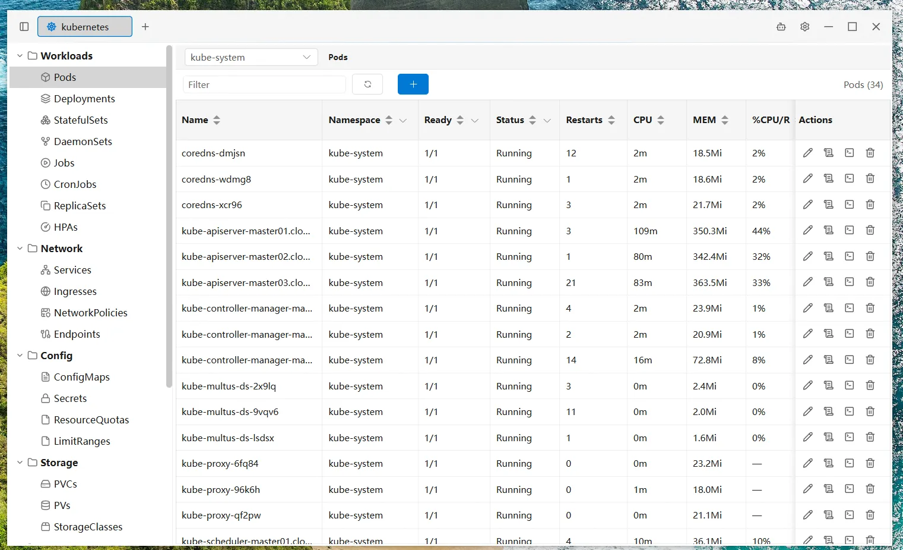
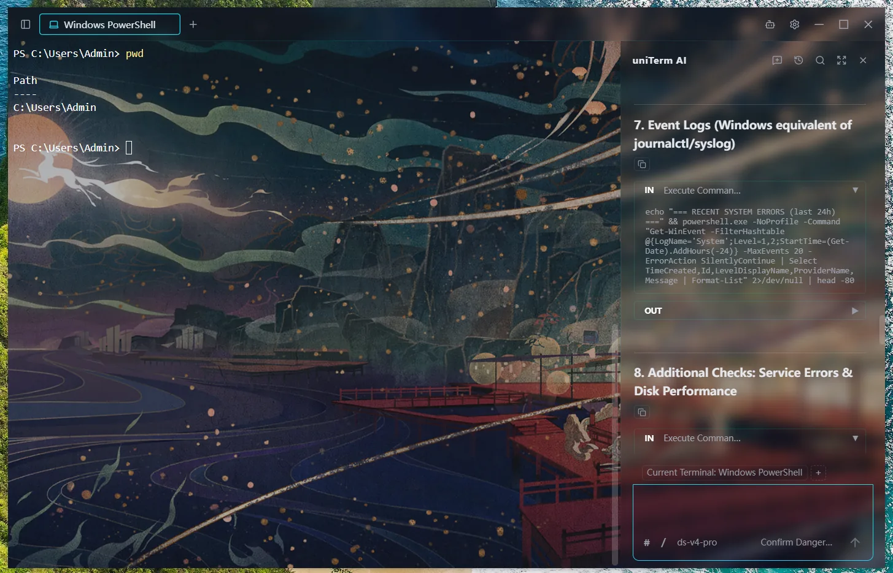

<div align="center">
  
  <h1>uniTerm</h1>
  <p>Terminal tout-en-un couvrant plus de 30 protocoles — SSH, RDP, SFTP, bases de données, Kubernetes et plus<br>Avec un Agent IA intégré capable d'exécuter de manière autonome des commandes shell en plusieurs tours</p>
  <p><a href="https://uniterm.net">🌐 Site web</a> &nbsp;|&nbsp; <a href="https://uniterm.net/guide/en/introduction">📖 Guide de l'utilisateur</a> &nbsp;|&nbsp; <a href="https://github.com/ys-ll/uniterm">💻 GitHub</a> &nbsp;|&nbsp; <a href="https://gitee.com/ys-l/uniterm">💻 Gitee</a></p>
</div>

<div align="center">

<a href="README_zh-CN.md">简体中文</a> &nbsp;|&nbsp; <a href="README_zh-TW.md">繁體中文</a> &nbsp;|&nbsp; <a href="README.md">English</a> &nbsp;|&nbsp; <a href="README_ja.md">日本語</a> &nbsp;|&nbsp; <a href="README_ko.md">한국어</a> &nbsp;|&nbsp; <a href="README_de.md">Deutsch</a> &nbsp;|&nbsp; <a href="README_es.md">Español</a> &nbsp;|&nbsp; Français &nbsp;|&nbsp; <a href="README_ru.md">Русский</a> &nbsp;|&nbsp; <a href="README_pt.md">Português</a> &nbsp;|&nbsp; <a href="README_vi.md">Tiếng Việt</a>

<br>

<a href="https://github.com/ys-ll/uniterm/releases/latest"></a>
<a href="https://github.com/ys-ll/uniterm"></a>
<a href="LICENSE"></a>
<a href="https://github.com/ys-ll/uniterm/releases"></a>
<a href="https://github.com/ys-ll/uniterm"></a>
<a href="https://gitee.com/ys-l/uniterm"></a>
<br>
<a href="https://trendshift.io/repositories/109042?utm_source=repository-badge&amp;utm_medium=badge&amp;utm_campaign=badge-repository-109042" target="_blank" rel="noopener noreferrer"></a>
<a href="https://alternativeto.net/software/uniterm/about/?utm_source=badge&amp;utm_medium=referral" target="_blank">
  
</a>

</div>

## Table des matières

- [Fonctionnalités](#fonctionnalités)
- [Protocoles pris en charge](#protocoles-pris-en-charge)
- [Captures d'écran](#captures-décran)
- [Téléchargement](#téléchargement)
- [Flux de travail rapides](#flux-de-travail-rapides)
- [Stack technique](#stack-technique)
- [Compiler depuis les sources](#compiler-depuis-les-sources)
- [Structure du projet](#structure-du-projet)
- [Feuille de route](#feuille-de-route)
- [Étoilez ce projet](#étoilez-ce-projet)
- [Retours et contributions](#retours-et-contributions)
- [Licence](#licence)

## Fonctionnalités

### Terminal complet

Terminal distant, terminal local et série, transfert de fichiers, bureau à distance, bases de données, conteneurs et supervision de serveurs — tout ce dont vous avez besoin pour l'accès distant.

- **Terminal distant** — SSH / Telnet / Mosh / TCP brut avec authentification par mot de passe ou par clé ; inclut le transfert de port par tunnel SSH afin que toute connexion puisse passer par un hôte de rebond SSH.
- **Terminal local et série** — PowerShell / CMD / Git Bash / WSL, plus des connexions série avec vitesse (baud rate), bits de données, bits d'arrêt, parité et écho local configurables.
- **Transfert de fichiers** — SFTP / SCP / FTP / FTPS / SMB / WebDAV / S3 / Zmodem avec navigation à double volet et prise en charge de `rz`/`sz` dans les terminaux SSH.
- **Bureau à distance** — RDP (bureau à distance Windows), VNC (contrôle à distance Linux), SPICE (machines virtuelles KVM/QEMU), X11 (redirection X Window)
- **Client de bases de données** — MySQL / PostgreSQL / Oracle / SQL Server / SQLite / rqlite / Redis / MongoDB / Elasticsearch, avec requêtes en langage naturel assistées par IA et édition des lignes de données.
- **Kubernetes et conteneurs** — Kubernetes / Docker / Podman / nerdctl (containerd) / WSLC, avec gestion des ressources et des images du cluster, journaux et terminaux exec des Pods, et métriques CPU/mémoire.
- **Supervision de serveurs** — CPU, mémoire, disque, réseau, processus, ports et interfaces réseau en temps réel.

### Agent IA

Agent IA autonome qui planifie et exécute indépendamment des commandes shell en plusieurs tours, directement dans votre terminal.

- **Agent IA autonome** — L'Agent IA peut planifier, exécuter, observer les résultats et itérer sur plusieurs rounds de commandes shell sans intervention manuelle ; chat latéral avec API compatible Anthropic/OpenAI, prenant en charge Claude, GPT et autres modèles compatibles.
- **Modes d'exécution flexibles** — Contournement total, dangereuses uniquement, dangereuses + écriture, ou tout confirmer — vous contrôlez le niveau de supervision dont l'Agent IA a besoin.
- **Intégration au terminal** — Les commandes de l'IA s'exécutent directement dans l'onglet de terminal actif, avec épinglage optionnel à un onglet spécifique ou suivi de l'onglet actif. Collaborez côte à côte dans des volets divisés, chacun avec son propre contexte de terminal.
- **Serveur MCP** — Serveur MCP intégré permettant à des agents IA externes (Claude Code, Codex, Gemini CLI, ...) d'exécuter des commandes et de transférer des fichiers sur les connexions enregistrées — les identifiants ne quittent jamais l'application.
- **Compétences et commandes** — Flux de travail de compétences réutilisables et commandes à partir de modèles de prompt, attachables avec `/` dans la saisie de l'IA ; l'IA peut également enregistrer elle-même de nouvelles compétences.
- **Complétion intelligente** — Complétion en temps réel pendant la saisie, basée sur l'historique des commandes et les capacités de l'IA.

### Personnalisation

Gestion des connexions, volets divisés, synchronisation cloud, thèmes et i18n — votre terminal, à votre façon.

- **Gestionnaire de connexions** — Regroupement, recherche rapide, création et opérations par lot des connexions serveur.
- **Espace de travail** — Faites glisser les onglets de terminal dans la zone de contenu pour les diviser librement et les combiner en un espace de travail ; faites glisser les bords des panneaux pour redimensionner et réorganiser.
- **Synchronisation cloud** — Synchronisation cloud chiffrée en cinq modes : dépôt Git, WebDAV, SFTP, S3 et SMB — sans craindre la perte ni la fuite de données, et reprenez votre travail en toute transparence entre les appareils.
- **Raccourcis clavier personnalisés** — Associez librement des raccourcis clavier à chaque action pour une utilisation entièrement au clavier, sans jamais quitter le clavier.
- **Thèmes et internationalisation** — 28 thèmes de terminal plus 3 thèmes d'interface (Sombre / Bleu profond / Clair) et une image de fond personnalisable ; interface en 11 langues : chinois simplifié, chinois traditionnel, anglais, japonais, coréen, allemand, espagnol, français, russe, portugais, vietnamien.

## Protocoles pris en charge

| Catégorie | Protocole | Description |
|----------|----------|-------------|
| Terminal | SSH | Gestion du shell des serveurs distants |
| Terminal | Telnet | Terminal distant pour les appareils anciens et les systèmes embarqués |
| Terminal | Mosh | Connexions aux serveurs sur des réseaux à forte latence ou intermittents |
| Terminal | Série | Terminal de port série avec vitesse et autres paramètres configurables |
| Terminal | TCP brut | Console TCP brut qui ouvre une socket simple et échange des octets bruts |
| Terminal | Local | PowerShell, CMD, Git Bash et autres shells locaux |
| Terminal | WSL | Ouverture des distributions WSL installées via le terminal local (Windows uniquement) |
| Transfert de fichiers | SFTP | Gestion et transfert des fichiers du serveur |
| Transfert de fichiers | SCP | Protocole de secours pour les serveurs SSH anciens ne prenant pas en charge SFTP |
| Transfert de fichiers | FTP / FTPS | Hébergement de sites web, transfert de fichiers NAS |
| Transfert de fichiers | SMB | Dossiers partagés Windows, accès aux fichiers NAS |
| Transfert de fichiers | WebDAV | Gestion des fichiers d'un serveur WebDAV |
| Transfert de fichiers | S3 | Stockage d'objets compatible Amazon S3 |
| Transfert de fichiers | Zmodem | Transfert de fichiers dans le terminal via les commandes rz/sz |
| Bureau à distance | RDP | Gestion du bureau à distance des serveurs Windows |
| Bureau à distance | VNC | Contrôle à distance des serveurs Linux |
| Bureau à distance | SPICE | Gestion des machines virtuelles KVM/QEMU |
| Bureau à distance | X11 | Redirection X Window |
| Base de données | MySQL | Protocole MySQL : MySQL, MariaDB, TiDB et plus |
| Base de données | PostgreSQL | Protocole PostgreSQL : PostgreSQL, CockroachDB et plus |
| Base de données | Oracle Database | Connexions Oracle Database via un pilote Go pur |
| Base de données | SQL Server | Connexions SQL Server via un pilote Go pur |
| Base de données | SQLite | Base de données locale embarquée, connexion en ouvrant le fichier de base de données |
| Base de données | rqlite | Base de données distribuée légère construite sur SQLite avec consensus Raft |
| Base de données | Redis | Magasin clé-valeur en mémoire avec navigation et édition visuelle des clés |
| Base de données | MongoDB | Base de données documentaire avec navigation arborescente, éditeur de requêtes et édition en ligne |
| Base de données | Elasticsearch | Moteur de recherche et d'analyse distribué avec gestion des index et des documents |
| Conteneurs | Kubernetes | Navigation et gestion des ressources du cluster, journaux et exec des Pods, métriques de performance |
| Conteneurs | Docker | Gestion des conteneurs et des images, en local ou sur des hôtes distants via SSH |
| Conteneurs | Podman | Moteur de conteneurs compatible Docker, en local ou sur des hôtes distants via SSH |
| Conteneurs | nerdctl (containerd) | Gestion des conteneurs containerd avec changement d'espace de noms |
| Conteneurs | WSLC | Runtime de conteneurs Windows WSL2 (Windows uniquement) |

La prise en charge d'Oracle Database est implémentée avec un pilote Go pur. uniTerm ne regroupe ni Oracle Database, ni Oracle Instant Client, ni OJDBC, ni fichiers wallet, ni éléments de marque Oracle ; les utilisateurs sont responsables de leurs propres licences Oracle, identifiants et accès aux bases de données.

## Captures d'écran

<p align="center">
  <picture>
    <source srcset="docs/imgs/start_tab.webp" media="(prefers-color-scheme: dark)" />
    
  </picture>
  <picture>
    <source srcset="docs/imgs/new_connection.webp" media="(prefers-color-scheme: dark)" />
    
  </picture>
</p>
<p align="center">
  <picture>
    <source srcset="docs/imgs/ai_assistant.webp" media="(prefers-color-scheme: dark)" />
    
  </picture>
  <picture>
    <source srcset="docs/imgs/workspace.webp" media="(prefers-color-scheme: dark)" />
    
  </picture>
</p>
<p align="center">
  <picture>
    <source srcset="docs/imgs/sftp.webp" media="(prefers-color-scheme: dark)" />
    
  </picture>
  <picture>
    <source srcset="docs/imgs/database.webp" media="(prefers-color-scheme: dark)" />
    
  </picture>
</p>
<p align="center">
  <picture>
    <source srcset="docs/imgs/kubernetes.webp" media="(prefers-color-scheme: dark)" />
    
  </picture>
  
</p>

## Téléchargement

Récupérez les derniers binaires précompilés depuis [GitHub Releases](https://github.com/ys-ll/uniterm/releases) ou [Gitee Releases](https://gitee.com/ys-l/uniterm/releases) :

- **Windows** (amd64 / arm64) : installateur `uniterm-windows-*-installer-*.exe`, ou version portable `uniterm-windows-*-portable-*.zip`
- **macOS** (Apple Silicon arm64 / Intel amd64) : téléchargez `uniterm-darwin-*-*.dmg`
- **Linux** (amd64 / arm64) : téléchargez `uniterm-linux-*-*.tar.gz`, `.deb` ou `.rpm`
- **Android** (arm64) : téléchargez `uniterm-android-arm64-*.apk`
- **Docker** (amd64 / arm64) : déploiement web multi-tenant — un déploiement serveur accessible depuis un navigateur où chaque utilisateur dispose d'un espace de travail isolé, voir le [guide de déploiement Docker](https://github.com/ys-ll/uniterm/blob/main/deploy/docker/README.md)

> **À propos des faux positifs des antivirus Windows** : ce logiciel open source n'ayant pas acheté de certificat de signature de code, l'exécutable non signé peut déclencher des faux positifs dans certains moteurs antivirus (par exemple Windows Defender). Il s'agit d'un problème connu des applications Go/Wails (voir [wailsapp/wails#3308](https://github.com/wailsapp/wails/issues/3308)). Vous pouvez ajouter une règle d'exclusion dans votre antivirus pour l'autoriser. Veuillez télécharger uniquement depuis les canaux officiels open source — GitHub et Gitee. Si vous avez encore des inquiétudes concernant les logiciels malveillants, vous pouvez télécharger le code source et le compiler et l'exécuter vous-même en local.

### Gestionnaires de paquets

```bash
# Windows
scoop bucket add uniterm https://github.com/ys-ll/scoop-uniterm && scoop install uniterm

# macOS
brew install --cask ys-ll/uniterm/uniterm

# Linux (deb)
curl -sLo uniterm.deb https://github.com/ys-ll/uniterm/releases/latest/download/uniterm-linux-amd64-*.deb
sudo dpkg -i uniterm.deb

# Linux (rpm)
curl -sLo uniterm.rpm https://github.com/ys-ll/uniterm/releases/latest/download/uniterm-linux-amd64-*.rpm
sudo rpm -i uniterm.rpm
```

### Dépendances d'exécution

- **Windows** : runtime WebView2 (inclus dans Windows 10+ ; les versions plus anciennes nécessitent une installation unique)
- **macOS** : aucune dépendance supplémentaire (utilise le WebKit du système)
- **Linux** : `libgtk-3-0` et `libwebkit2gtk-4.1-0` (préinstallées sur la plupart des distributions de bureau)
- **Android** : Android 5.0+ (utilise le WebView du système, aucune dépendance supplémentaire)
- **Docker** : seul Docker Engine est requis sur l'hôte (Docker Compose v2 pour les déploiements compose) ; l'image embarque toutes les dépendances d'exécution

## Flux de travail rapides

### Connexion SSH

1. Cliquez sur **Nouvelle connexion** dans le Gestionnaire de connexions
2. Renseignez l'hôte, le port et l'authentification (mot de passe ou clé privée)
3. Cliquez sur **Connecter** pour ouvrir une session de terminal SSH

### Agent IA

1. Rendez-vous dans les Paramètres et configurez votre **fournisseur IA** (endpoint de l'API, modèle et clé)
2. Ouvrez un onglet de terminal (SSH ou local)
3. Ouvrez le chat latéral de l'IA — saisissez votre tâche, et l'Agent IA exécute les commandes directement dans votre terminal

### Transfert de fichiers SFTP

1. Dans le Gestionnaire de connexions, faites un **clic droit** sur une connexion SSH
2. Sélectionnez **Connecter SFTP**
3. Parcourez, téléversez, téléchargez et faites glisser des fichiers dans le gestionnaire de fichiers à double volet

## Stack technique

| Couche | Technologie |
|-------|-----------|
| Framework de bureau | Wails v3 |
| Backend | Go |
| Frontend | Vue 3 + Pinia + Element Plus |
| Terminal | xterm.js |
| Protocole IA | Anthropic Messages API / OpenAI Chat Completions API |

## Compiler depuis les sources

- [Go](https://go.dev/dl/) 1.26+
- [Node.js](https://nodejs.org/) 20+
- [CLI wails3](https://wails.io/docs/) v3.1.0 (installer avec `go install github.com/wailsapp/wails/v3/cmd/wails3@v3.1.0`)
- macOS nécessite les Xcode Command Line Tools
- Linux nécessite `libgtk-3-dev` et `libwebkit2gtk-4.1-dev`
- Les builds Android nécessitent en plus JDK 21 et le SDK/NDK Android (`sdkmanager "platform-tools" "platforms;android-35" "build-tools;35.0.0" "ndk;26.3.11579264"`)

```bash
git clone https://github.com/ys-ll/uniterm.git
cd uniTerm
cd frontend && npm install && cd ..
wails3 dev                  # Development
wails3 build                # Production build
```

## Structure du projet

```
uniTerm/
├── main.go                       # Entry point
├── app.go                        # Wails bindings, LLM API proxy, SFTP API
├── app_*.go                      # Platform-specific implementations
├── backend/
│   ├── session/                  # SSH/Telnet/Serial/SFTP/database session management
│   ├── database/                 # SQL execution, schema introspection, DSN builders
│   ├── container/                # Docker/Podman/nerdctl container management
│   ├── k8s/                      # Kubernetes cluster management
│   ├── store/                    # Persistent config (connections, AI, settings)
│   ├── sync/                     # Cloud sync (Git / WebDAV)
│   ├── update/                   # Auto-update
│   ├── platform/                 # Platform abstraction layer
│   └── log/                      # File-based logging
├── frontend/
│   └── src/
│       ├── components/           # Vue components
│       ├── composables/          # Terminal composables
│       ├── stores/               # Pinia stores
│       ├── services/             # AI agent loop, LLM client
│       ├── i18n/                 # Translations
│       ├── types/                # TypeScript type definitions
│       ├── utils/                # Utility functions
│       └── vendor/               # Third-party libraries
├── plugins/                      # Plugin directory
├── docs/                         # Documentation
├── Taskfile.yml                  # wails3 build tasks
└── build/
    └── config.yml                # build config (app info, dev mode)
```

## Feuille de route

Consultez [ROADMAP.md](ROADMAP.md) pour l'état actuel des protocoles / fonctionnalités et ce qui est prévu ensuite. Pour l'historique par version, voir [CHANGELOG.md](CHANGELOG.md).

## Étoilez ce projet

Si uniTerm vous est utile, pensez à lui donner une ⭐ Star — c'est la meilleure des encouragements pour le projet et cela aide davantage de personnes à le découvrir.

[](https://github.com/ys-ll/uniterm)
[](https://gitee.com/ys-l/uniterm)

<a href="https://www.star-history.com/?repos=ys-ll%2Funiterm&type=date&legend=top-left">
 <picture>
   <source media="(prefers-color-scheme: dark)" srcset="https://api.star-history.com/chart?repos=ys-ll/uniterm&type=date&legend=top-left&sealed_token=EJf9Yr6aVGkBwIbfGQ6u9hRwpxdIl7vVpUJshd8jaRUCw-OkotyrQX9qzDP5cXNidgLvC0yq8ltQivK06MxiTJYOxkVbPCPuIuCBZj7aTkMxUA-mqJk2KA" />
   <source media="(prefers-color-scheme: light)" srcset="https://api.star-history.com/chart?repos=ys-ll/uniterm&type=date&legend=top-left&sealed_token=EJf9Yr6aVGkBwIbfGQ6u9hRwpxdIl7vVpUJshd8jaRUCw-OkotyrQX9qzDP5cXNidgLvC0yq8ltQivK06MxiTJYOxkVbPCPuIuCBZj7aTkMxUA-mqJk2KA" />
   
 </picture>
</a>

## Retours et contributions

Il s'agit d'un projet personnel de loisir maintenu par l'auteur pendant son temps libre, sans plan de commercialisation ni de sponsorisation — toute personne partageant le même intérêt est chaleureusement invitée à rejoindre, discuter et construire ensemble.

Les issues, suggestions et retours sont bienvenus sur [GitHub Issues](https://github.com/ys-ll/uniterm/issues), et les contributions de code via [Pull Request](https://github.com/ys-ll/uniterm/pulls) sont toujours les bienvenues. En raison de la grande variété des environnements de terminal et des scénarios d'utilisation, l'auteur ne peut couvrir tous les cas possibles lors des tests — si vous rencontrez des problèmes, n'hésitez pas à forker le projet et à contribuer directement. Ce projet accueille le vibe coding.

Merci aux personnes suivantes pour leurs contributions de code et leurs améliorations, et à toutes celles qui ont signalé des issues et partagé des suggestions — vous contribuez à rendre uniTerm meilleur ❤️

<table>
  <tr>
    <td align="center"><a href="https://github.com/yuwei5380">@yuwei5380</a></td>
    <td align="center"><a href="https://github.com/surenwuyuwuqiu">@surenwuyuwuqiu</a></td>
    <td align="center"><a href="https://github.com/wangxufeng">@wangxufeng</a></td>
    <td align="center"><a href="https://github.com/coderstory">@coderstory</a></td>
  </tr>
  <tr>
    <td align="center"><a href="https://github.com/jiayunora">@jiayunora</a></td>
    <td align="center"><a href="https://github.com/iCarrear">@iCarrear</a></td>
    <td align="center"><a href="https://github.com/boltomli">@boltomli</a></td>
    <td align="center"><a href="https://github.com/kxn">@kxn</a></td>
  </tr>
  <tr>
    <td align="center"><a href="https://github.com/windtear">@windtear</a></td>
    <td align="center"><a href="https://github.com/Sunshow">@Sunshow</a></td>
    <td align="center"><a href="https://github.com/feuvan">@feuvan</a></td>
    <td align="center"><a href="https://github.com/zhangsir1211">@zhangsir1211</a></td>
  </tr>
  <tr>
    <td align="center"><a href="https://github.com/sonnartliao">@sonnartliao</a></td>
    <td align="center"><a href="https://github.com/Teejer">@Teejer</a></td>
    <td align="center"><a href="https://github.com/IBRAHIMELAMRABET">@IBRAHIMELAMRABET</a></td>
    <td align="center"><a href="https://github.com/chris-edstrom">@chris-edstrom</a></td>
  </tr>
  <tr>
    <td align="center"><a href="https://github.com/andreafunicelli">@andreafunicelli</a></td>
    <td align="center"><a href="https://github.com/dungvv">@dungvv</a></td>
    <td align="center"><a href="https://github.com/zhongqian97">@zhongqian97</a></td>
    <td align="center"><a href="https://github.com/laigcss">@laigcss</a></td>
  </tr>
  <tr>
    <td align="center"><a href="https://github.com/lutzr400">@lutzr400</a></td>
    <td align="center"><a href="https://github.com/Merrcurys">@Merrcurys</a></td>
    <td align="center"><a href="https://github.com/etanman">@etanman</a></td>
    <td align="center"><a href="https://github.com/wuqiang57">@wuqiang57</a></td>
  </tr>
  <tr>
    <td align="center"><a href="https://github.com/lijinxiao1982">@lijinxiao1982</a></td>
    <td align="center"><a href="https://github.com/mikemikimike">@mikemikimike</a></td>
    <td align="center"><a href="https://github.com/macoladik">@macoladik</a></td>
    <td align="center"><a href="https://github.com/NatureLProokie">@NatureLProokie</a></td>
  </tr>
  <tr>
    <td align="center"><a href="https://github.com/kevin9327">@kevin9327</a></td>
    <td align="center"><a href="https://github.com/gezerui888">@gezerui888</a></td>
    <td align="center"><a href="https://github.com/eltociear">@eltociear</a></td>
  </tr>
</table>

## Licence

Apache 2.0
