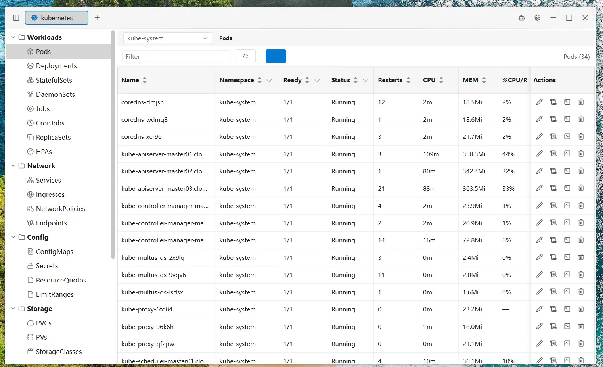
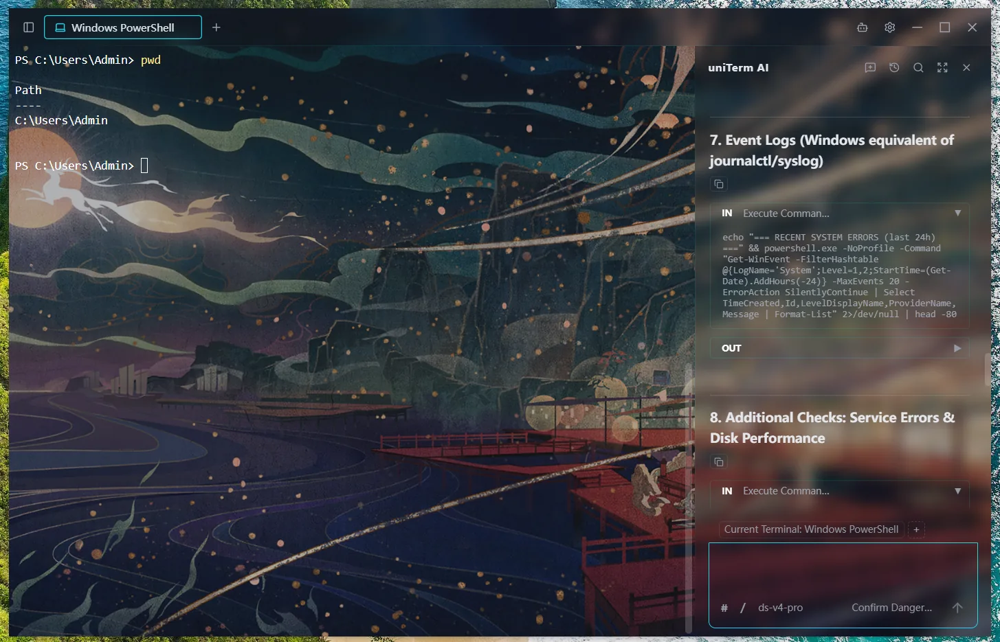

<div align="center">
  
  <h1>uniTerm</h1>
  <p>SSH, RDP, SFTP, veritabanları, Kubernetes ve daha fazlasını kapsayan 30+ protokollü hepsi bir arada terminal<br>Çok turlu kabuk komutlarını otonom olarak çalıştıran yerleşik yapay zekâ ajanı ile</p>
  <p><a href="https://uniterm.net">🌐 Ana Sayfa</a> &nbsp;|&nbsp; <a href="https://uniterm.net/guide/en/introduction">📖 Kullanım Kılavuzu</a> &nbsp;|&nbsp; <a href="https://github.com/ys-ll/uniterm">💻 GitHub</a> &nbsp;|&nbsp; <a href="https://gitee.com/ys-l/uniterm">💻 Gitee</a></p>
</div>

<div align="center">

<a href="README_zh-CN.md">简体中文</a> &nbsp;|&nbsp; <a href="README_zh-TW.md">繁體中文</a> &nbsp;|&nbsp; <a href="README.md">English</a> &nbsp;|&nbsp; <a href="README_ja.md">日本語</a> &nbsp;|&nbsp; <a href="README_ko.md">한국어</a> &nbsp;|&nbsp; <a href="README_de.md">Deutsch</a> &nbsp;|&nbsp; <a href="README_es.md">Español</a> &nbsp;|&nbsp; <a href="README_fr.md">Français</a> &nbsp;|&nbsp; <a href="README_ru.md">Русский</a> &nbsp;|&nbsp; <a href="README_pt.md">Português</a> &nbsp;|&nbsp; <a href="README_vi.md">Tiếng Việt</a> &nbsp;|&nbsp; Türkçe

<br>

<a href="https://github.com/ys-ll/uniterm/releases/latest"></a>
<a href="https://github.com/ys-ll/uniterm"></a>
<a href="LICENSE"></a>
<a href="https://github.com/ys-ll/uniterm/releases"></a>
<a href="https://github.com/ys-ll/uniterm"></a>
<a href="https://gitee.com/ys-l/uniterm"></a>
<br>
<a href="https://trendshift.io/repositories/109042?utm_source=repository-badge&amp;utm_medium=badge&amp;utm_campaign=badge-repository-109042" target="_blank" rel="noopener noreferrer"></a>
<a href="https://alternativeto.net/software/uniterm/about/?utm_source=badge&amp;utm_medium=referral" target="_blank">
  
</a>

</div>

## İçindekiler

- [Özellikler](#özellikler)
- [Desteklenen Protokoller](#desteklenen-protokoller)
- [Ekran Görüntüleri](#ekran-görüntüleri)
- [İndirme](#i̇ndirme)
- [Hızlı İş Akışları](#hızlı-i̇ş-akışları)
- [Teknoloji Yığını](#teknoloji-yığını)
- [Kaynaktan Derleme](#kaynaktan-derleme)
- [Proje Yapısı](#proje-yapısı)
- [Yol Haritası](#yol-haritası)
- [Bu Projeye Yıldız Verin](#bu-projeye-yıldız-verin)
- [Geri Bildirim ve Katkıda Bulunma](#geri-bildirim-ve-katkıda-bulunma)
- [Lisans](#lisans)

## Özellikler

### Tam Donanımlı Terminal

Uzak terminal, yerel ve seri terminal, dosya aktarımı, uzak masaüstü, veritabanı, konteynerler ve sunucu izleyici — tüm uzak erişim ihtiyaçlarını kapsar.

- **Terminal** — SSH / Telnet / Mosh / Raw TCP / Seri bağlantı ve yerel kabuklar (PowerShell / CMD / Git Bash / WSL).
- **Dosya Aktarımı** — Çift bölmeli gezinme ve SSH terminallerinde `rz`/`sz` desteğiyle SFTP / SCP / FTP / FTPS / SMB / WebDAV / S3 / Yerel Dosya / WSL Dosya / Zmodem.
- **Uzak Masaüstü** — RDP (Windows Uzak Masaüstü), VNC (Linux uzaktan kontrol), SPICE (KVM/QEMU sanal makineleri), X11 (X Window yönlendirme).
- **Veritabanı İstemcisi** — MySQL / PostgreSQL / Oracle / SQL Server / SQLite / ClickHouse / Redis / MongoDB / Elasticsearch dahil 30'dan fazla veritabanı, yapay zekâ destekli doğal dil sorguları ve veri satırı düzenleme özellikleriyle.
- **Kubernetes ve Konteynerler** — Küme kaynak ve imaj yönetimi, Pod günlükleri ile exec terminalleri ve CPU/bellek metrikleriyle Kubernetes / Docker / Podman / nerdctl (containerd) / WSLC.
- **Sunucu İzleyici** — Gerçek zamanlı CPU, bellek, disk, ağ, süreçler, portlar ve ağ arayüzleri.

### Yapay Zekâ Ajanı

Doğrudan terminalinizde çok turlu kabuk komutlarını bağımsız olarak planlayıp yürüten otonom yapay zekâ ajanı.

- **Otonom Yapay Zekâ Ajanı** — Yapay zekâ ajanı manuel müdahale olmadan birden fazla tur boyunca kabuk komutlarını planlayabilir, çalıştırabilir, sonuçları gözlemleyebilir ve yineleyebilir; Claude, GPT ve diğer uyumlu modelleri destekleyen Anthropic/OpenAI uyumlu API ile kenar çubuğu sohbeti.
- **Esnek Yürütme Modları** — Atla (Bypass), yalnızca tehlikeli, tehlikeli + yazma veya tümünü onayla — yapay zekâ ajanının ne kadar gözetim gerektirdiğini siz kontrol edersiniz.
- **Terminal Entegrasyonu** — Yapay zekâ komutları doğrudan etkin terminal sekmesinde çalışır; isteğe bağlı olarak belirli bir sekmeye sabitlenebilir veya etkin sekmenizi takip edebilir. Her biri kendi terminal bağlamına sahip bölünmüş bölmelerde yan yana çalışın.
- **MCP Sunucusu** — Harici yapay zekâ ajanlarının (Claude Code, Codex, Gemini CLI, ...) kayıtlı bağlantılar üzerinde komut çalıştırmasına ve dosya aktarmasına olanak tanıyan yerleşik MCP sunucusu — kimlik bilgileri asla uygulamadan dışarı çıkmaz.
- **Beceriler ve Komutlar** — Yapay zekâ girişinde `/` ile eklenen yeniden kullanılabilir beceri iş akışları ve istem şablonu komutları; yapay zekâ kendi başına yeni beceriler de kaydedebilir; yapay zekânın araç kutusunu genişletmek için harici MCP sunucuları da bağlanabilir.
- **Akıllı Tamamlama** — Komut geçmişine ve yapay zekâ yeteneklerine dayalı olarak yazarken gerçek zamanlı tamamlama.

### Kişiselleştirme

Bağlantı yönetimi, bölünmüş bölmeler, bulut eşitleme, temalar ve çoklu dil desteği — sizin terminaliniz, sizin tarzınız.

- **Bağlantı Yöneticisi** — Sunucu bağlantılarını gruplayın, arayın ve toplu yönetin; şifreli içe/dışa aktarma ve diğer terminal uygulamalarından (MobaXterm, Xshell vb.) içe aktarma.
- **Çalışma Alanı** — Terminal sekmelerini serbestçe bölmek ve bir çalışma alanında birleştirmek için içerik alanına sürükleyin; yeniden boyutlandırmak ve yeniden düzenlemek için panel kenarlarını sürükleyin.
- **Ağ Araç Kutusu** — Diğer cihazlar için geçici sunucular çalıştırmak üzere ağ taraması, SSH port yönlendirme tünelleri, trafik yakalama, güvenlik duvarı yönetimi ve yerel servisler.
- **Bulut Eşitleme** — Beş modda şifreli bulut eşitleme: Git deposu, WebDAV, SFTP, S3 ve SMB — veri kaybı veya sızıntısı endişesi olmadan cihazlar arasında çalışmanıza kesintisiz devam edin.
- **Temalar ve Uluslararasılaştırma** — 28 terminal teması, 3 arayüz teması (Koyu / Koyu Mavi / Açık) ve özelleştirilebilir arka plan görseli; 11 dilli arayüz: Basitleştirilmiş Çince, Geleneksel Çince, İngilizce, Japonca, Korece, Almanca, İspanyolca, Fransızca, Rusça, Portekizce, Vietnamca.

## Desteklenen Protokoller

| Kategori | Protokol | Açıklama |
|----------|----------|----------|
| Terminal | SSH | Uzak sunucu kabuk yönetimi |
| Terminal | Telnet | Eski cihazlar ve gömülü sistemler için uzak terminal |
| Terminal | Mosh | Yüksek gecikmeli veya kesintili ağlar üzerinden sunucu bağlantıları |
| Terminal | Serial | Yapılandırılabilir baud hızı ve diğer parametrelerle seri port terminali |
| Terminal | Raw TCP | Düz bir soket açan ve ham baytları alıp gönderen ham TCP konsolu |
| Terminal | Local | PowerShell, CMD, Git Bash ve diğer yerel kabuklar |
| Terminal | WSL | Yerel terminal üzerinden yüklü WSL dağıtımlarını açın (yalnızca Windows) |
| Dosya Aktarımı | SFTP | Sunucu dosya yönetimi ve aktarımı |
| Dosya Aktarımı | SCP | SFTP desteklemeyen eski SSH sunucuları için yedek protokol |
| Dosya Aktarımı | FTP / FTPS | Web sitesi barındırma, NAS dosya aktarımı |
| Dosya Aktarımı | SMB | Windows paylaşımlı klasörleri, NAS dosya erişimi |
| Dosya Aktarımı | WebDAV | WebDAV sunucusu dosya yönetimi |
| Dosya Aktarımı | S3 | Amazon S3 uyumlu nesne depolama |
| Dosya Aktarımı | Local File | Yerel dosya sistemi üzerinde çift bölmeli tarayıcı |
| Dosya Aktarımı | WSL File | WSL dağıtımları için dosya tarayıcısı (yalnızca Windows) |
| Dosya Aktarımı | Zmodem | `rz`/`sz` komutlarıyla terminal içi dosya aktarımı |
| Uzak Masaüstü | RDP | Windows sunucu uzak masaüstü yönetimi |
| Uzak Masaüstü | VNC | Linux sunucu uzaktan kontrolü |
| Uzak Masaüstü | SPICE | KVM/QEMU sanal makine yönetimi |
| Uzak Masaüstü | X11 | X Window yönlendirme |
| Veritabanı | MySQL | MySQL protokolü: MySQL, MariaDB, TiDB ve daha fazlası |
| Veritabanı | PostgreSQL | PostgreSQL protokolü: PostgreSQL, CockroachDB ve daha fazlası |
| Veritabanı | Oracle Database | Saf Go sürücüsü üzerinden Oracle Database bağlantıları |
| Veritabanı | SQL Server | Saf Go sürücüsü üzerinden SQL Server bağlantıları |
| Veritabanı | SQLite | Gömülü yerel veritabanı, veritabanı dosyasını açarak bağlanın |
| Veritabanı | ClickHouse | Yerel protokolü üzerinden sütun odaklı OLAP veritabanı |
| Veritabanı | rqlite | Raft mutabakatı ile SQLite üzerine kurulu hafif dağıtık veritabanı |
| Veritabanı | DM (Dameng) | Saf Go sürücüsü üzerinden DM8 bağlantıları |
| Veritabanı | GBase 8s | Saf Go sürücüsü üzerinden GBase 8s bağlantıları |
| Veritabanı | Redis | Görsel anahtar tarama ve düzenleme ile bellek içi anahtar-değer deposu |
| Veritabanı | MongoDB | Ağaç görünümü, sorgu düzenleyici ve satır içi düzenleme ile belge veritabanı |
| Veritabanı | Elasticsearch | Dizin ve belge yönetimli dağıtık arama ve analitik motoru |
| Konteynerler | Kubernetes | Küme kaynak tarama ve yönetimi, Pod günlükleri ve exec, performans metrikleri |
| Konteynerler | Docker | Yerel makinede veya SSH üzerinden uzak ana makinelerde konteyner ve imaj yönetimi |
| Konteynerler | Podman | Yerel makinede veya SSH üzerinden uzak ana makinelerde Docker uyumlu konteyner motoru |
| Konteynerler | nerdctl (containerd) | Ad alanı değiştirme ile containerd konteyner yönetimi |
| Konteynerler | WSLC | Windows WSL2 Konteyner çalışma zamanı (yalnızca Windows) |

Oracle Database desteği saf Go sürücüsüyle uygulanmıştır. uniTerm; Oracle Database, Oracle Instant Client, OJDBC, cüzdan dosyaları veya Oracle marka varlıklarını paketlemez; kullanıcılar kendi Oracle lisanslarından, kimlik bilgilerinden ve veritabanı erişimlerinden sorumludur.

## Ekran Görüntüleri

<p align="center">
  <picture>
    <source srcset="docs/imgs/start_tab.webp" media="(prefers-color-scheme: dark)" />
    
  </picture>
  <picture>
    <source srcset="docs/imgs/new_connection.webp" media="(prefers-color-scheme: dark)" />
    
  </picture>
</p>
<p align="center">
  <picture>
    <source srcset="docs/imgs/ai_assistant.webp" media="(prefers-color-scheme: dark)" />
    
  </picture>
  <picture>
    <source srcset="docs/imgs/workspace.webp" media="(prefers-color-scheme: dark)" />
    
  </picture>
</p>
<p align="center">
  <picture>
    <source srcset="docs/imgs/sftp.webp" media="(prefers-color-scheme: dark)" />
    
  </picture>
  <picture>
    <source srcset="docs/imgs/database.webp" media="(prefers-color-scheme: dark)" />
    
  </picture>
</p>
<p align="center">
  <picture>
    <source srcset="docs/imgs/kubernetes.webp" media="(prefers-color-scheme: dark)" />
    
  </picture>
  
</p>

## İndirme

En son önceden derlenmiş ikili dosyaları [GitHub Releases](https://github.com/ys-ll/uniterm/releases) veya [Gitee Releases](https://gitee.com/ys-l/uniterm/releases) sayfasından edinin:

- **Windows** (amd64 / arm64): yükleyici `uniterm-windows-*-installer-*.exe` veya taşınabilir `uniterm-windows-*-portable-*.zip`
- **macOS** (Apple Silicon arm64 / Intel amd64): `uniterm-darwin-*-*.dmg` dosyasını indirin
- **Linux** (amd64 / arm64): `uniterm-linux-*-*.tar.gz`, `.deb` veya `.rpm` dosyasını indirin
- **Android** (arm64): `uniterm-android-arm64-*.apk` dosyasını indirin
- **Docker** (amd64 / arm64): web çok kiracılı dağıtım — her kullanıcının izole bir çalışma alanı aldığı tarayıcıdan erişilebilir sunucu dağıtımı, bkz. [Docker dağıtım kılavuzu](https://github.com/ys-ll/uniterm/blob/main/deploy/docker/README.md)

> **Windows antivirüs hatalı pozitifleri hakkında**: Bu açık kaynaklı yazılım için kod imzalama sertifikası satın alınmadığından, imzasız çalıştırılabilir dosya bazı antivirüs motorlarında (ör. Windows Defender) hatalı pozitif uyarısı verebilir. Bu, Go/Wails uygulamalarında bilinen bir durumdur (bkz. [wailsapp/wails#3308](https://github.com/wailsapp/wails/issues/3308)). İzin vermek için antivirüsünüzde bir dışlama kuralı ekleyebilirsiniz. Lütfen yalnızca resmi açık kaynak kanallarından — GitHub ve Gitee'den — indirin. Kötü amaçlı yazılımdan hâlâ endişe ediyorsanız kaynak kodunu indirip kendiniz yerel olarak derleyip çalıştırabilirsiniz.

### Paket Yöneticileri

```bash
# Windows
scoop bucket add uniterm https://github.com/ys-ll/scoop-uniterm && scoop install uniterm

# macOS
brew install --cask ys-ll/uniterm/uniterm

# Linux (deb)
curl -sLo uniterm.deb https://github.com/ys-ll/uniterm/releases/latest/download/uniterm-linux-amd64-*.deb
sudo dpkg -i uniterm.deb

# Linux (rpm)
curl -sLo uniterm.rpm https://github.com/ys-ll/uniterm/releases/latest/download/uniterm-linux-amd64-*.rpm
sudo rpm -i uniterm.rpm
```

### Çalışma Zamanı Bağımlılıkları

- **Windows**: WebView2 çalışma zamanı (Windows 10+ ile birlikte gelir; daha eski sürümler için tek seferlik kurulum gerekir)
- **macOS**: Ek bağımlılık yok (sistem WebKit'ini kullanır)
- **Linux**: `libgtk-3-0` ve `libwebkit2gtk-4.1-0` (çoğu masaüstü dağıtımında önceden yüklüdür)
- **Android**: Android 5.0+ (sistem WebView'ını kullanır, ek bağımlılık yoktur)
- **Docker**: ana makinede yalnızca Docker Engine (compose dağıtımları için Docker Compose v2); imaj tüm çalışma zamanı bağımlılıklarıyla birlikte gelir

## Hızlı İş Akışları

### SSH Bağlantısı

1. Bağlantı Yöneticisinde **New Connection** düğmesine tıklayın
2. Ana makine, port ve kimlik doğrulama (parola veya özel anahtar) bilgilerini doldurun
3. Bir SSH terminal oturumu açmak için **Connect** düğmesine tıklayın

### Yapay Zekâ Ajanı

1. Ayarlar'a gidin ve **AI provider** (API uç noktası, model ve anahtar) bilgilerinizi yapılandırın
2. Bir terminal sekmesi (SSH veya yerel) açın
3. Yapay zekâ kenar çubuğu sohbetini açın — görevinizi yazın, yapay zekâ ajanı komutları doğrudan terminalinizde çalıştırsın

### SFTP Dosya Aktarımı

1. Bağlantı Yöneticisinde bir SSH bağlantısına **sağ tıklayın**
2. **Connect SFTP** seçeneğini seçin
3. Çift bölmeli dosya yöneticisinde dosyalara göz atın, yükleyin, indirin ve sürükleyip bırakın

## Teknoloji Yığını

| Katman | Teknoloji |
|-------|-----------|
| Masaüstü Çatısı | Wails v3 |
| Arka Uç | Go |
| Ön Yüz | Vue 3 + Pinia + Element Plus |
| Terminal | xterm.js |
| Yapay Zekâ Protokolü | Anthropic Messages API / OpenAI Chat Completions API |

## Kaynaktan Derleme

- [Go](https://go.dev/dl/) 1.26+
- [Node.js](https://nodejs.org/) 20+
- [wails3 CLI](https://wails.io/docs/) v3.1.0 (`go install github.com/wailsapp/wails/v3/cmd/wails3@v3.1.0` ile kurun)
- macOS için Xcode Command Line Tools gerekir
- Linux için `libgtk-3-dev` ve `libwebkit2gtk-4.1-dev` gerekir
- Android derlemeleri için ek olarak JDK 21 ve Android SDK/NDK (`sdkmanager "platform-tools" "platforms;android-35" "build-tools;35.0.0" "ndk;26.3.11579264"`) gerekir

```bash
git clone https://github.com/ys-ll/uniterm.git
cd uniTerm
cd frontend && npm install && cd ..
wails3 dev                  # Geliştirme
wails3 build                # Üretim derlemesi
```

## Proje Yapısı

```
uniTerm/
├── main.go                       # Giriş noktası
├── app.go                        # Wails bağlamaları, LLM API vekili, SFTP API
├── app_*.go                      # Platforma özgü uygulamalar
├── backend/
│   ├── session/                  # SSH/Telnet/Serial/SFTP/veritabanı oturum yönetimi
│   ├── database/                 # SQL yürütme, şema inceleme, DSN oluşturucular
│   ├── container/                # Docker/Podman/nerdctl konteyner yönetimi
│   ├── k8s/                      # Kubernetes küme yönetimi
│   ├── store/                    # Kalıcı yapılandırma (bağlantılar, AI, ayarlar)
│   ├── sync/                     # Bulut eşitleme (Git / WebDAV)
│   ├── update/                   # Otomatik güncelleme
│   ├── platform/                 # Platform soyutlama katmanı
│   └── log/                      # Dosya tabanlı günlükleme
├── frontend/
│   └── src/
│       ├── components/           # Vue bileşenleri
│       ├── composables/          # Terminal composable'ları
│       ├── stores/               # Pinia depoları
│       ├── services/             # Yapay zekâ ajanı döngüsü, LLM istemcisi
│       ├── i18n/                 # Çeviriler
│       ├── types/                # TypeScript tür tanımları
│       ├── utils/                # Yardımcı işlevler
│       └── vendor/               # Üçüncü taraf kütüphaneler
├── plugins/                      # Eklenti dizini
├── docs/                         # Dokümantasyon
├── Taskfile.yml                  # wails3 derleme görevleri
└── build/
    └── config.yml                # derleme yapılandırması (uygulama bilgisi, geliştirme modu)
```

## Yol Haritası

Mevcut protokol / özellik durumu ve sonraki planlar için bkz. [ROADMAP.md](ROADMAP.md). Sürüm bazlı geçmiş için bkz. [CHANGELOG.md](CHANGELOG.md).

## Bu Projeye Yıldız Verin

uniTerm işinize yarıyorsa lütfen ⭐ Star vermeyi düşünün — bu, proje için en büyük teşviktir ve daha fazla kişinin projeyi keşfetmesine yardımcı olur.

[](https://github.com/ys-ll/uniterm)
[](https://gitee.com/ys-l/uniterm)

<a href="https://www.star-history.com/?repos=ys-ll%2Funiterm&type=date&legend=top-left">
 <picture>
   <source media="(prefers-color-scheme: dark)" srcset="https://api.star-history.com/chart?repos=ys-ll/uniterm&type=date&theme=dark&legend=top-left&sealed_token=EJf9Yr6aVGkBwIbfGQ6u9hRwpxdIl7vVpUJshd8jaRUCw-OkotyrQX9qzDP5cXNidgLvC0yq8ltQivK06MxiTJYOxkVbPCPuIuCBZj7aTkMxUA-mqJk2KA" />
   <source media="(prefers-color-scheme: light)" srcset="https://api.star-history.com/chart?repos=ys-ll/uniterm&type=date&legend=top-left&sealed_token=EJf9Yr6aVGkBwIbfGQ6u9hRwpxdIl7vVpUJshd8jaRUCw-OkotyrQX9qzDP5cXNidgLvC0yq8ltQivK06MxiTJYOxkVbPCPuIuCBZj7aTkMxUA-mqJk2KA" />
   
 </picture>
</a>

## Geri Bildirim ve Katkıda Bulunma

Bu, yazarın boş zamanlarında sürdürdüğü, ticarileştirme veya sponsorluk planı olmayan kişisel bir hobi projesidir — aynı ilgiyi paylaşan herkesin katılması, tartışması ve birlikte geliştirmesi memnuniyetle karşılanır.

Sorunlar, öneriler ve geri bildirimler [GitHub Issues](https://github.com/ys-ll/uniterm/issues) üzerinden, kod katkıları ise [Pull Request](https://github.com/ys-ll/uniterm/pulls) aracılığıyla her zaman memnuniyetle karşılanır. Terminal ortamlarının ve kullanım senaryolarının çok çeşitli olması nedeniyle yazar testlerde olası her durumu kapsayamayabilir — herhangi bir sorunla karşılaşırsanız projeyi çatallamaktan ve doğrudan katkıda bulunmaktan çekinmeyin. Bu proje vibe coding'e açıktır.

Kod ve iyileştirme katkısında bulunan aşağıdaki kişilere ve sorun bildirip öneri paylaşan herkese teşekkürler — uniTerm'i daha iyi hale getirmeye yardımcı oluyorsunuz ❤️

<table>
  <tr>
    <td align="center"><a href="https://github.com/yuwei5380">@yuwei5380</a></td>
    <td align="center"><a href="https://github.com/surenwuyuwuqiu">@surenwuyuwuqiu</a></td>
    <td align="center"><a href="https://github.com/wangxufeng">@wangxufeng</a></td>
    <td align="center"><a href="https://github.com/coderstory">@coderstory</a></td>
  </tr>
  <tr>
    <td align="center"><a href="https://github.com/jiayunora">@jiayunora</a></td>
    <td align="center"><a href="https://github.com/iCarrear">@iCarrear</a></td>
    <td align="center"><a href="https://github.com/boltomli">@boltomli</a></td>
    <td align="center"><a href="https://github.com/kxn">@kxn</a></td>
  </tr>
  <tr>
    <td align="center"><a href="https://github.com/windtear">@windtear</a></td>
    <td align="center"><a href="https://github.com/Sunshow">@Sunshow</a></td>
    <td align="center"><a href="https://github.com/feuvan">@feuvan</a></td>
    <td align="center"><a href="https://github.com/zhangsir1211">@zhangsir1211</a></td>
  </tr>
  <tr>
    <td align="center"><a href="https://github.com/sonnartliao">@sonnartliao</a></td>
    <td align="center"><a href="https://github.com/Teejer">@Teejer</a></td>
    <td align="center"><a href="https://github.com/IBRAHIMELAMRABET">@IBRAHIMELAMRABET</a></td>
    <td align="center"><a href="https://github.com/chris-edstrom">@chris-edstrom</a></td>
  </tr>
  <tr>
    <td align="center"><a href="https://github.com/andreafunicelli">@andreafunicelli</a></td>
    <td align="center"><a href="https://github.com/dungvv">@dungvv</a></td>
    <td align="center"><a href="https://github.com/zhongqian97">@zhongqian97</a></td>
    <td align="center"><a href="https://github.com/laigcss">@laigcss</a></td>
  </tr>
  <tr>
    <td align="center"><a href="https://github.com/lutzr400">@lutzr400</a></td>
    <td align="center"><a href="https://github.com/Merrcurys">@Merrcurys</a></td>
    <td align="center"><a href="https://github.com/etanman">@etanman</a></td>
    <td align="center"><a href="https://github.com/wuqiang57">@wuqiang57</a></td>
  </tr>
  <tr>
    <td align="center"><a href="https://github.com/lijinxiao1982">@lijinxiao1982</a></td>
    <td align="center"><a href="https://github.com/mikemikimike">@mikemikimike</a></td>
    <td align="center"><a href="https://github.com/macoladik">@macoladik</a></td>
    <td align="center"><a href="https://github.com/NatureLProokie">@NatureLProokie</a></td>
  </tr>
  <tr>
    <td align="center"><a href="https://github.com/kevin9327">@kevin9327</a></td>
    <td align="center"><a href="https://github.com/gezerui888">@gezerui888</a></td>
    <td align="center"><a href="https://github.com/eltociear">@eltociear</a></td>
    <td align="center"><a href="https://github.com/dajiaohuang">@dajiaohuang</a></td>
  </tr>
  <tr>
    <td align="center"><a href="https://github.com/rsipka">@rsipka</a></td>
    <td align="center"><a href="https://github.com/caibingxin666">@caibingxin666</a></td>
    <td align="center"><a href="https://github.com/zcy85611">@zcy85611</a></td>
    <td align="center"><a href="https://github.com/AuroraLZDF">@AuroraLZDF</a></td>
  </tr>
  <tr>
    <td align="center"><a href="https://github.com/guberm">@guberm</a></td>
    <td align="center"><a href="https://github.com/zielony360">@zielony360</a></td>
    <td align="center"><a href="https://github.com/AnxysUaen">@AnxysUaen</a></td>
    <td align="center"><a href="https://github.com/it-linnan">@it-linnan</a></td>
  </tr>
  <tr>
    <td align="center"><a href="https://github.com/Burakceliks">@Burakceliks</a></td>
  </tr>
</table>

## Lisans

Apache 2.0
